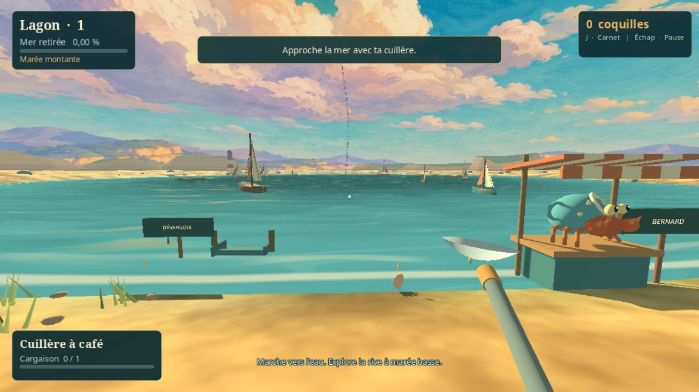

# SPOONFUL V2 · Audit de la version jouable

Version examinée : [v1.0.0, commit 87f8c46](https://github.com/Fares1212/inde-game/tree/87f8c4642be037c8c026a8c62d926b80b558662b). Les captures ci-dessous proviennent du jeu publié. Les décisions et temps cibles de la seconde moitié de ce document concernent la V2 à construire.

## Ce que le joueur rencontre

La vue de départ montre trois indications de marche ou de puisage, un panneau en mer et un comptoir à droite. Pourtant, le geste important reste difficile à deviner visuellement : où s’accroupir, ce que contient la cuillère et par où ressort l’eau qu’on verse. La première minute de la V2 doit répondre à ces trois questions par l’écume au bord d’une flaque, le reflet dans la cuillère et le filet d’eau qui descend dans la goulotte. Le gag du premier millionième peut alors tenir dans un seul « plic ».

## Moteur et organisation

Le projet déclare Godot 4.5 et impose **GL Compatibility** sur ordinateur et mobile. Le script de construction épingle **4.5.1 stable**. Le binaire de test s’identifie comme **4.5.1.stable.official.f62fdbde1**. Le rendu avec fenêtre a utilisé OpenGL. La base UI est 1 280 × 720, avec `canvas_items` et `expand`.

| Partie | Où elle vit en V1 |
|---|---|
| Scènes | `Game/scenes/Boot.tscn` charge `Menu.tscn` puis le menu ouvre `Game.tscn`. En jeu, `game.gd` crée la côte, le joueur avec caméra et outil, puis un CanvasLayer pour le HUD et les fenêtres. |
| Rendu et déplacements | `shore.gd` calcule le terrain et la carte de profondeur. `coast.gd` construit et anime la côte. `forms.gd` fabrique les maillages. `player.gd` gère marche, sprint, caméra, modèle tenu et pas. Les shaders sont dans `Game/shaders/`. |
| Inventaire, économie et marée | L’autoload `Voyage` dans `voyage.gd` gère volume, remplissage, trouvailles, prix, horloge et prestige. `Game/Data/basins.json` contient six outils, six régions et dix-huit types d’objets. |
| HUD, comptoir, carnet et menus | `game.gd` gère interactions, achat/vente, indicateurs, dialogues et fin. `ui.gd` fabrique les contrôles et les réglages. `menu.gd` compose l’écran titre. |
| Son | L’autoload `Sound` dans `sound.gd` gère les lecteurs et les bus. Les phrases figurent dans `basins.json`, les enregistrements dans `Game/audio/generated/` et leur fabrication dans `Tools/compose.py`. |
| Sauvegarde et vérification | `Voyage` écrit `voyage.json`, un temporaire et une copie de secours. `Game/qa/probe.gd` teste le parcours jusqu’au bassin suivant. |

## Constats vérifiés

| Sujet | Ce que fait la V1 et sa conséquence |
|---|---|
| Ciel et côte | Le panorama peint contient des montagnes et des nuages très détaillés. Les falaises jouables ont des valeurs plates, les rochers se répètent et les objets proches manquent de matière. Les deux horizons se lisent indépendamment. |
| Eau et sable | La profondeur et l’écume existent déjà. La mer emploie un shader sans éclairage de scène, avec deux bandes proches du rivage. L’écume forme de longs traits clairs. Le sable échantillonne un bruit sur XZ, ce qui l’étire sur les pentes. La transition humide existe mais les rides et les cuvettes rocheuses manquent. |
| Ombres, faune et bateaux | Le soleil projette jusqu’à 78 m. La qualité active ou désactive les ombres et laisse plusieurs réglages au moteur. Les silhouettes proches méritent un budget dédié. La coque se pose à partir d’un seul point du sol et d’une inclinaison prédéfinie. La chaîne monte sur 67 maillons sans appui supérieur et révèle le mystère dès le départ. Les oiseaux tournent en groupe et le varech est statique. |
| Bernard | Sa tasse et ses pinces le rendent identifiable. Sa table a deux plans, son auvent est une série de parallélépipèdes et son enseigne occupe autant d’espace visuel que lui. Les étagères, la toile qui pend, les attaches et ses effets personnels donneraient un usage et une échelle à la boutique. |
| Récipients et sensations | La louche possède une concavité, difficile à lire en vue subjective. Le seau superpose deux tores pour le bord et l’anse. Le niveau d’eau n’apparaît dans aucun des deux. Un même mouvement de l’outil illustre puisage et livraison. Le versement crédite toute la cargaison d’un coup. |
| Jauge et unités | Avec 360 000 unités sur 100 000 000, le texte affiche **0,36 %**. La barre calcule le chemin entre les seuils 6 000 et 420 000, soit 85,51 %, arrondi à **86 %** par le contrôle mesuré en jeu. Les petits pourcentages occupent jusqu’à six décimales. « 70,0 k » ne donne aucune indication physique. |
| Lecture et commandes | Le HUD utilise des panneaux sombres semblables, du texte parfois à 12–15 px et plusieurs éléments placés par décalages fixes. Le bouton d’action reste à l’écran loin de l’objet ciblé. Le sous-titre appartient au HUD derrière les fenêtres. Le jeu utilise des polices système variables. Il manque des réglages de taille et de débit du texte, le remappage et les commandes complètes à la manette. |
| Objets et contenants | Le niveau d’outil, l’eau portée et les objets ont déjà des champs distincts (`tier`, `bag`, `cargo`). En revanche, ils partagent le même dictionnaire général, les entrées de collection utilisent des indices numériques et le comptoir réunit l’achat du récipient et la vente de la besace dans le même panneau. Le carnet affiche une ligne de texte pour les objets inconnus. |
| Économie et trajet | La capacité passe de 1 à 1 600 puis à 70 000 unités. Un seau plein vaut déjà 0,07 % du bassin initial. Chaque déversement positif rapporte au moins une coquille, ce qui favorise les petites livraisons. Un seau chargé ralentit de 6 % et courir conserve toute l’eau. Le déversoir le plus proche devient accessible à chaque région. Après la dernière amélioration, les coquilles perdent leur usage. |
| Marées et durée | Le cycle de 156 s change la hauteur visible. Le volume retiré ne fait que croître. Les éoliennes extraient 65 000 unités/s avant modulation, l’éponge 90 000. À son taux moyen, l’éponge automatique retire l’équivalent de 50 % du premier bassin en environ neuf minutes. Le « 0,5 % en 30 s » est le retour du joueur. Une session humaine chronométrée reste à mesurer. |
| Récit et tests | La V1 offre un dénouement suivi du prestige. Le récit du souvenir de Bernard, les trois choix, leur sauvegarde commune et la promenade d’après-fin restent à écrire. Les 242 vérifications rejouées sous Linux passent mais le test téléporte le joueur et remet le délai de puisage à zéro. Il vérifie les règles et les transactions. La durée humaine et les performances sur GPU de milieu de gamme demandent d’autres mesures. |

### Bernard, reproduction du défaut

Les sept voix sont des Ogg mono à 24 kHz avec la boucle désactivée. Une seule piste de parole joue sur le bus Voice. En ouvrant le comptoir puis en vendant avant la fin du bonjour, le lecteur remplace immédiatement `vo_shop` par `vo_sale`. Il joue encore 150 ms après la fermeture du panneau lors du diagnostic. Pendant que la fenêtre est ouverte, le chronomètre du sous-titre est resté à 6,0625 s après 270 ms d’attente. Ces essais ont utilisé la sortie audio factice et vérifié l’état du lecteur. Ils établissent la coupure et la désynchronisation. L’audibilité d’un éventuel clic demande une écoute.

## Direction artistique

**Une crique de marée basse au couchant.** La première référence donne la courbe de la plage, ses larges facettes et la progression du bleu vers le turquoise. La photographie guide le placement des roches mouillées, des cuvettes et de la laisse de mer. L’étal en bois donne la profondeur, le poids du tissu et l’échelle des accessoires. Le ciel sera reconstruit avec de grandes masses cohérentes avec le relief.

| Élément | Règle de réalisation |
|---|---|
| Palette | Bleu profond `#244D64`, eau peu profonde `#49B5AC`, sable `#E8BB78`, toile crème `#F6E6C7`, terre cuite `#B96449`, encre `#24363A`. Un éclat chaud sur le métal et le bord humide suffit. |
| Formes | Silhouettes larges à distance. Petits chanfreins et marques d’usage sur les objets à portée de main. Une touche sombre sous une lèvre, un pied ou une attache donne l’épaisseur. |
| Lumière | Un soleil bas guide le regard vers le rivage. Remplissage froid dans les creux, ombres de contact peintes, brume de distance et rayon solaire discret à intensité réglable. |
| Interface | **Bitter** pour les enseignes et les titres, **Source Sans 3** pour les actions et le dialogue. Embarquer les deux familles avec leurs licences. Prévoir 18 px pour les actions, 22 px pour la parole au format de référence. Tester « Épave », « cœur », « Çà », « 1 600 mL » et le focus manette. |
| Première vue à valider | Depuis le point de départ, voir la cuillère de trois quarts, une flaque à gauche, la goulotte dont le conduit se prolonge vers la plage et l’étal de Bernard à droite. Après un clic, voir l’eau dans le bol. Au comptoir, une petite tasse ébréchée annonce l’histoire de sa maison. |

Le rendu de compatibilité permet la brume de distance, les ombres directionnelles et un traitement plein écran léger. Les choix de matériaux et de lumière proposés fonctionnent dans ce renderer. [Matrice des fonctionnalités de Godot 4.5](https://docs.godotengine.org/en/4.5/tutorials/rendering/renderers.html)

## Ordre de réalisation et critères de fin

Les chemins ci-dessous identifient les fichiers existants à modifier ou les nouveaux composants prévus. Pour chaque livraison, consigner les fichiers effectivement changés, la manipulation de vérification dans l’éditeur et son résultat.

| Phase | Travail et fichiers concernés | Vérification de sortie |
|---|---|---|
| 1 · Audit et style | Ce document. Captures de référence de la V1 et mesures ci-dessus. | Ouvrir `Game/project.godot` avec 4.5.1, lancer F6 sur la scène de jeu dans un profil de test, observer le rivage et effectuer une vente pendant le bonjour de Bernard. |
| 2 · Données et sauvegarde | Ajouter `VesselData`, `ItemData` et deux inventaires. Faire évoluer `voyage.gd` de schema 1 à 2. Établir une table stable des anciens indices. Convertir la fraction de bassin vidée et la proportion remplie du récipient. Garder le solde, le tier, le bassin, les objets, le carnet et les achats. Conserver la V1 avant écriture. | Ouvrir trois copies de parties V1, dont une avancée et une au dénouement. Comparer avant/après, rouvrir la V2 deux fois, vérifier la récupération d’une sauvegarde corrompue. |
| 3 · Équilibrage | Une ressource de progression alimente `voyage.gd`, les vitesses de `player.gd`, les distances des quais et un simulateur headless. Essayer un renfort de manche à 1–2 min, puis l’achat de la louche à 6–10 min. Introduire débordement, digues et paliers de découverte entre les grands outils. F3 détaille débit brut, pertes et gain net. | Simuler deux profils incluant chargement, marche, vente, exploration et reflux. Exporter temps aux jalons et courbe de coquilles. Vérifier en jouant les premiers trajets. |
| 4 · Interface | Un `Theme.tres` pour le titre, le HUD, la pause, les réglages, le carnet et le comptoir. Une jauge globale et un marqueur de marée distinct. Eau en mL/L/m³, onglets Récipients et Objets, silhouettes de collection, invitation près de la cible. Dialogue réservé avec portrait. | Viser successivement le crabe, une trouvaille et la goulotte. Lire et acheter au clavier puis à la manette, vérifier les retours de focus et les réglages. Tester 960 × 540, 1080p, 1440p et ultralarge. |
| 5 · Voix | Ajouter `DialogueManager`, modifier `sound.gd`, la génération audio et les bus. File unique, sons de crabe par syllabe, enveloppes courtes, pauses de ponctuation, trois humeurs. La fenêtre gouverne la lecture, le saut, la fermeture et le ducking. | Répéter accueil → vente → achat → fermeture rapide. Vérifier silence dès fermeture, absence de reprise intempestive, cohérence du texte et retour de la musique. Écouter au casque. |
| 6 · Côte et lumière | Reprendre `shore.gd`, `coast.gd`, `forms.gd` et les shaders. Triplanaire sur les pentes, deux courants de normales, caustiques, écume brisée et mares de marée. Appuyer les coques sur plusieurs points, relier la chaîne à un treuil. Comptoir à quatre montants, toile cousue affaissée, cordages, étagères et casiers à coquilles. | Capturer la même vue à haute et basse mer. Examiner sol, coques, premier plan, ombres et ligne d’horizon depuis le point de départ puis à deux mètres de Bernard. |
| 7 · Gestes et vie | Récipients à paroi épaisse, anse articulée, eau visible qui suit accélération et freinage. Synchroniser main, puisage, arc de versement et décompte. Animer yeux et pinces, herbes, phare et goélands. | Prendre en jeu des vues du seau vide, à moitié plein et plein. Courir, s’arrêter, verser. Contrôler le niveau visible et le volume livré. |
| 8 · Choix et générique | Ajouter une sauvegarde avant le choix. **La Marée** rend la dernière cuillère à la mer. **Le Grand Vide** laisse le joueur dans le bassin silencieux. **La Maison** suppose le carnet complet et la restitution du souvenir de Bernard. Chaque scène reçoit sa lumière, son court motif musical, une phrase et un générique avec statistiques. | Recharger le même point de choix. Vérifier les conditions du secret, la persistance des fins vues, l’exploration libre et l’accès au bassin suivant. |
| 9 · Vérification et livraison | Étendre `Game/qa`, `Tools`, `Packaging` et le workflow de release. Garder une sauvegarde de référence par phase. | Rejouer un parcours au rythme humain, profiler les temps d’image sur matériel identifié avec cible de 16,7 ms, puis réinstaller et vérifier les exports natifs avant de créer la release V2. |

### Temps à viser dans le premier bassin

| Jalon | Joueur qui optimise | Joueur qui explore |
|---|---:|---:|
| Après 30 secondes | moins de 0,01 % | moins de 0,01 % |
| Première amélioration | 1–2 min | 1–2 min |
| Deuxième récipient | 6 min | 10 min |
| 1 % | 7 min | 12 min |
| 10 % | 25 min | 50 min |
| 50 % | 1 h 05 | 2 h 40 |
| Choix final | 2 h | 5 h |

Entre deux jalons, une découverte de rive, une rencontre, une nouvelle prise ou un objet d’histoire doit changer le trajet toutes les 10–15 minutes. Le barème se juge sur les temps simulés puis sur des sessions humaines chronométrées.
