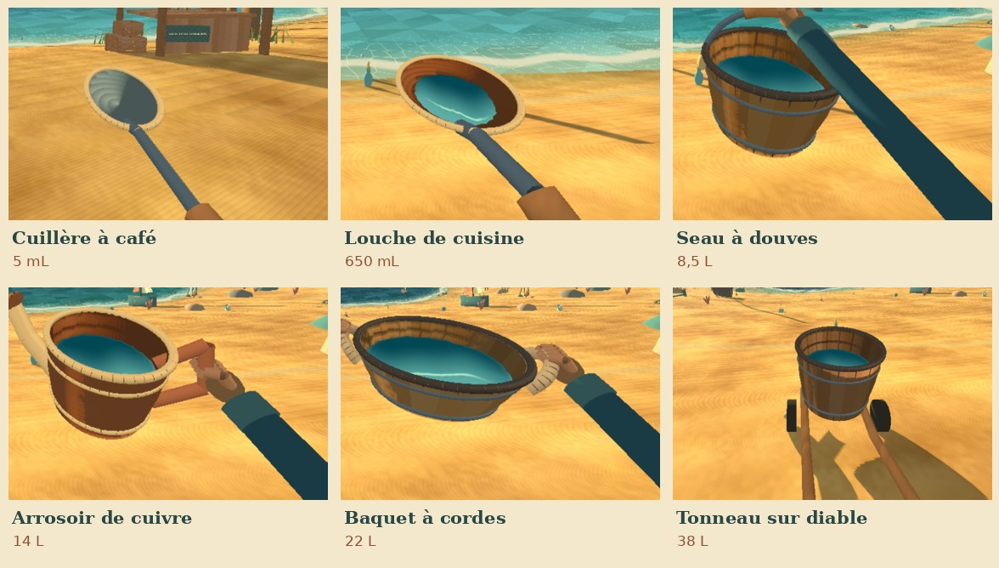
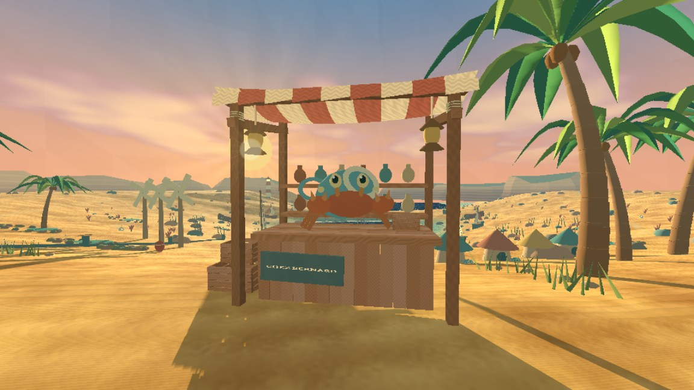

# SPOONFUL — La crique des objets perdus

Bernard te prête la cuillère de son café. Tu rapportes cinq millilitres au déversoir. Un petit « plic » résonne au bout du quai. Plus tard, sous une épave, tu reconnaîtras la couleur d’une fenêtre dont le crabe parle parfois.

**[Installer SPOONFUL 2.0.0 pour Windows 10/11 x64](https://github.com/Fares1212/inde-game/releases/download/v2.0.0/Spoonful-2.0.0-Windows-Setup.exe)** · [Versions macOS et Linux](https://github.com/Fares1212/inde-game/releases/tag/v2.0.0)


## La première marée

Marche jusqu’à l’écume et clique pour remplir la cuillère. Suis le déversoir sur ta boussole, puis verse avec **E**. Après cinq livraisons, Bernard peut raccorder le siphon pour huit coquilles. Dès lors, chaque récipient versé entraîne davantage d’eau au large. Regarde combien tu portes et combien le siphon retire réellement.

Surveille la marée, cherche les trouvailles sur la grève et revends-les au comptoir. Tu peux acheter une digue pour protéger ton avance ou un repère de pêche pour retrouver une page manquante. Six régions se découvrent autour de la même mer. À son point le plus bas, tu choisis ce que tu rends à la crique. Le jeu garde un point de retour avant le choix et propose ensuite la promenade libre.



| Commande par défaut | Action |
|---|---|
| ZQSD, WASD ou flèches | Marcher |
| Souris, Maj, Espace | Regarder, courir, sauter |
| Clic gauche | Puiser au bord de l’eau |
| E | Verser, ramasser ou parler |
| J, Échap | Ouvrir le carnet ou la pause |
| Tab | Avancer la réplique de Bernard |
| F2, F12 | Masquer l’interface ou prendre une photo |
| F3 | Afficher les débits du siphon et de la marée |
| Manette | Sticks pour marcher et regarder, RB pour puiser, X pour interagir |

Le carnet, les réglages et les photos sont enregistrés sur l’ordinateur. La partie se joue hors ligne et en français. Une partie de la première édition reprend avec son récipient, son argent, ses trouvailles et sa progression convertie.



## Ouvrir et vérifier le projet

Ouvre `Game/project.godot` dans Godot 4.5.1 et appuie sur F6 depuis la scène Boot ou sur F5. Le projet utilise le moteur de rendu OpenGL Compatibility.

```sh
godot --headless --editor --path Game --import
godot --headless --audio-driver Dummy --path Game -- --spoonful-test
godot --headless --audio-driver Dummy --path Game -- --spoonful-balance
```

Le premier parcours utilise une sauvegarde de vérification distincte et traverse les trois fins. Le second commande les mêmes systèmes de puisage, livraison et achat pour simuler deux rythmes de jeu. Le workflow GitHub exécute aussi le parcours avec rendu OpenGL. Il installe les paquets Windows et macOS sur leurs systèmes respectifs avant de publier.

[Conception et temps mesurés](Docs/GDD.md) · [Vérifications par phase](Docs/JOURNAL.md) · [Direction artistique et audit de la V1](Docs/AUDIT-V2.md) · [Historique](Docs/CHANGELOG.md)
