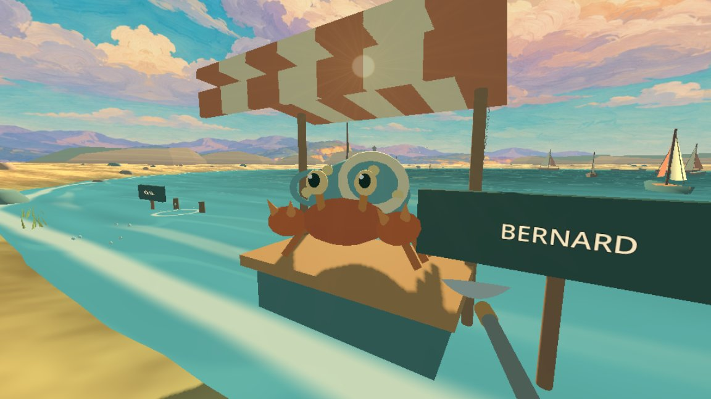

# SPOONFUL

Bernard t’attend derrière son comptoir de plage. Il a une cuillère, une caisse de coquilles et un travail à te proposer. À chaque marée, un peu plus du fond se découvre.

**[Télécharger le jeu et ses installateurs](https://github.com/Fares1212/inde-game/releases/latest)**


## Jouer

| Plateforme | Distribution |
|---|---|
| Windows 10 ou 11, 64 bits | Installateur par utilisateur, raccourci dans Démarrer |
| macOS Intel ou Apple Silicon | Paquet d’installation de l’application universelle |
| Linux x86-64 | Archive de l’exécutable et de son PCK |

Une souris et un clavier suffisent. Le jeu et la voix de Bernard sont en français. Sauvegardes, réglages, carnet et photos restent sur l’ordinateur. La partie tourne hors ligne.

| Commande | Action |
|---|---|
| ZQSD, WASD ou flèches | Marcher |
| Souris, Maj, Espace | Regarder, courir, sauter |
| Clic gauche | Puiser, puis maintenir pour les outils mécaniques |
| E | Verser, ramasser, parler à Bernard ou soulever la Bonde |
| J, Échap | Carnet, pause |
| F2, F12 | Masquer l’interface, enregistrer une photo |

Ramène d’abord une cuillère d’eau au déversoir. Les livraisons rapportent des coquilles. À marée basse, cherche aussi des objets et vends-les au crabe. Les nouveaux déversoirs réduisent la distance à parcourir lorsque la mer recule. Chaque bassin compte six régions, six outils et dix-huit notices à découvrir. Le carnet se transmet d’un bassin au suivant.



## Ouvrir le projet

Ouvre `Game/project.godot` avec Godot 4.5.1 puis lance la scène principale. Les ressources et les 27 pistes audio sont incluses. Le moteur utilise le rendu de compatibilité OpenGL. Les réglages du jeu permettent notamment d’abaisser la résolution 3D et de désactiver l’éblouissement.

La commande suivante joue automatiquement jusqu’au deuxième bassin dans une sauvegarde de vérification isolée.

```sh
godot --headless --editor --path Game --import
godot --headless --audio-driver Dummy --path Game -- --spoonful-test
```

Le workflow de livraison compile les exports, exécute le parcours avec rendu sous Linux puis vérifie les installateurs sous Windows et macOS avant la publication. Les finitions audio peuvent être reproduites avec `Tools/compose.py`. Les crédits du moteur figurent dans `Game/licenses` et au générique.

[Conception](Docs/GDD.md) · [Décisions de réalisation](Docs/DECISIONS.md) · [Historique](Docs/CHANGELOG.md)
