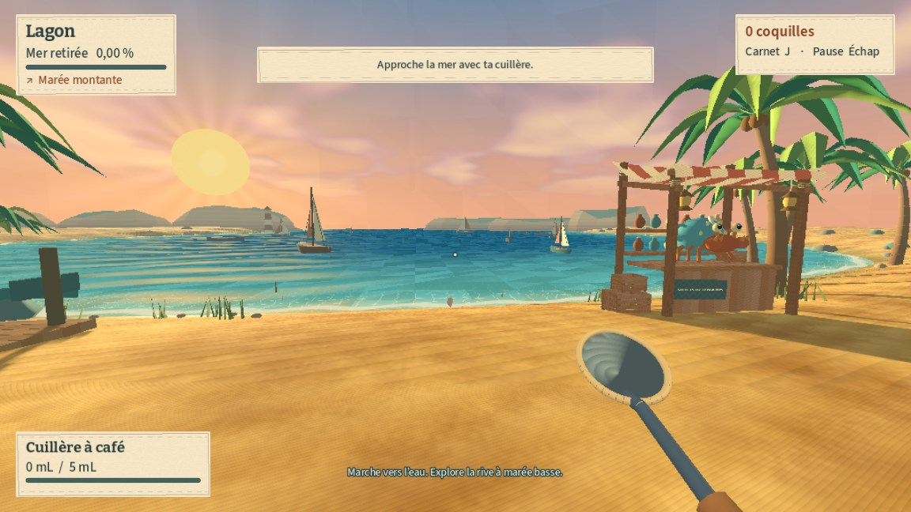
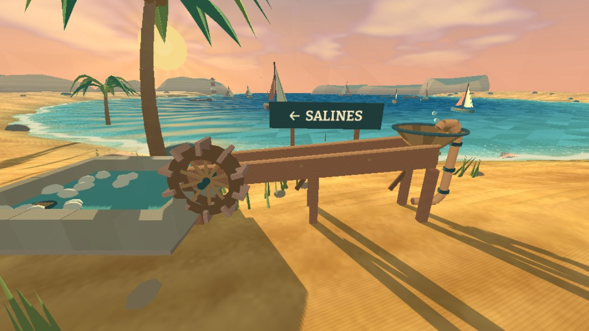
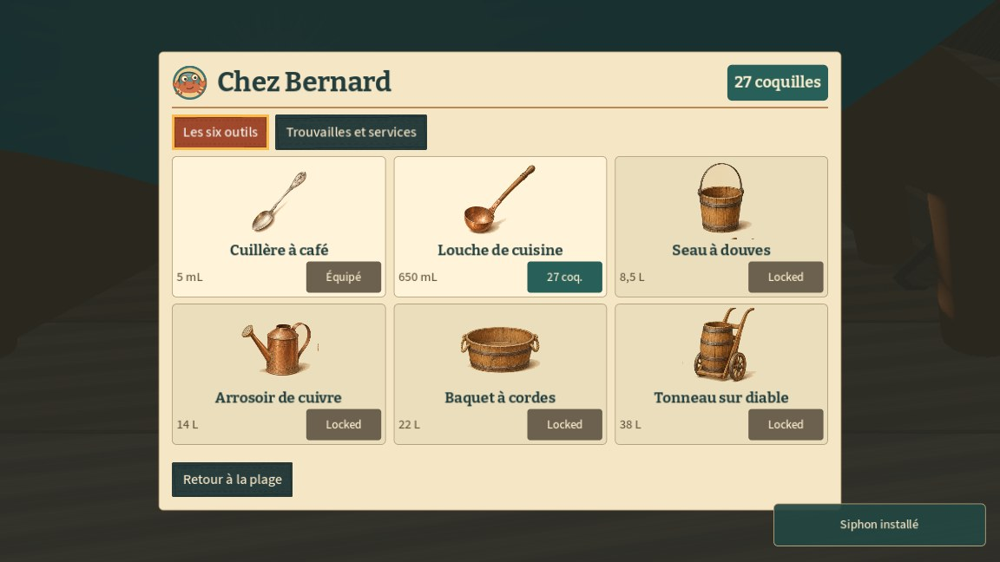

# SPOONFUL — La crique des objets perdus

Bernard te prête la cuillère de son café. Tu rapportes cinq millilitres au déversoir. Un petit « plic » résonne au bout du quai. Plus tard, sous une épave, tu reconnaîtras la couleur d’une fenêtre dont le crabe parle parfois.

**[Installer SPOONFUL 2.1.0 pour Windows 10/11 x64](https://github.com/Fares1212/inde-game/releases/download/v2.1.0/Spoonful-2.1.0-Windows-Setup.exe)** · [Versions macOS et Linux](https://github.com/Fares1212/inde-game/releases/tag/v2.1.0)



## La première marée

Au bord de l’écume, clique pour puiser. L’eau quitte la crique au moment où la cuillère se remplit. Marche jusqu’au panneau « ← SALINES » près du comptoir. Appuie sur **E** devant l’entonnoir. L’eau emprunte la rigole en bois, passe devant la roue et tombe dans les bassins de sel. La livraison te rapporte des coquilles.



Chez Bernard, les six outils tiennent sur une seule page. Un outil affiche son prix dès que son palier est ouvert. Amorce le siphon après cinq livraisons pour entraîner davantage d’eau à chaque puisage. Dans l’onglet des services, Bernard rachète tes trouvailles et vend des digues ou un repère pour explorer la rive.



Le carnet rassemble 30 types de trouvailles. La première coquille peut se découvrir après 5 mL retirés. Plus loin, une huître cache une perle, les épaves abritent une longue-vue, et la fosse garde un diadème de 720 coquilles. Il faut atteindre le seuil de retrait et pouvoir toucher l’objet découvert sur la grève. Les 18 pages du récit et la clé de Bernard gardent leur rôle dans les trois fins de la même mer.


| Commande par défaut | Action |
|---|---|
| ZQSD, WASD ou flèches | Marcher |
| Souris, Maj, Espace | Regarder, courir, sauter |
| Clic gauche | Puiser au bord de l’eau |
| E | Verser, ramasser ou parler |
| J, Échap | Ouvrir le carnet ou la pause |
| Tab | Avancer la réplique de Bernard |
| F2 | Ouvrir le menu de triche avec le code 1201 |
| F4, F12 | Masquer l’interface ou prendre une photo |
| F3 | Afficher les débits du siphon et de la marée |
| Manette | Sticks pour marcher et regarder, RB pour puiser, X pour interagir |

Le carnet, les réglages et les photos sont enregistrés sur l’ordinateur. La partie se joue hors ligne et en français. Une partie de la première édition reprend avec son récipient, son argent, ses trouvailles et sa progression convertie.


## Ouvrir et vérifier le projet

Ouvre `Game/project.godot` dans Godot 4.5.1 et appuie sur F6 depuis la scène Boot ou sur F5. Le projet utilise le moteur de rendu OpenGL Compatibility.

```sh
godot --headless --editor --path Game --import
godot --headless --audio-driver Dummy --path Game -- --spoonful-test
godot --headless --audio-driver Dummy --path Game -- --spoonful-balance
```

Le premier parcours utilise une sauvegarde de vérification distincte et traverse les trois fins. Le second commande les mêmes systèmes de puisage, livraison et achat pour simuler deux rythmes de jeu. Le workflow GitHub exécute aussi le parcours avec rendu OpenGL. Il installe les paquets Windows et macOS sur leurs systèmes respectifs avant de publier.

[Conception et temps mesurés](Docs/GDD.md) · [Vérifications par phase](Docs/JOURNAL.md) · [Direction artistique et audit de la V1](Docs/AUDIT-V2.md) · [Historique](Docs/CHANGELOG.md)
